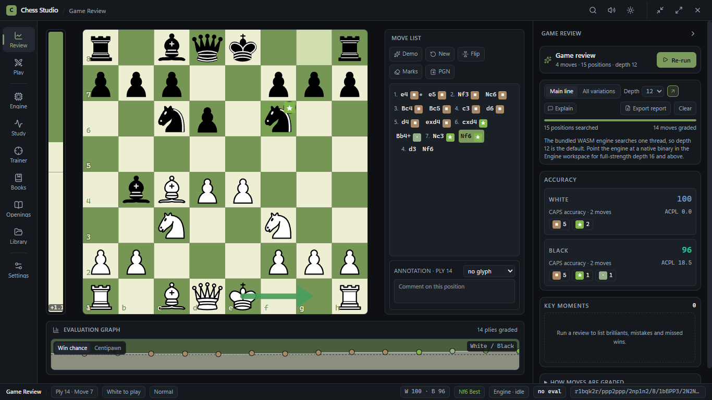
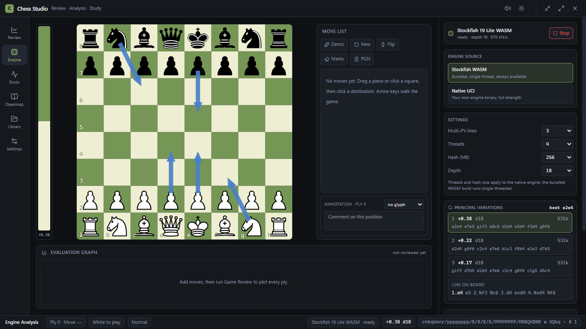
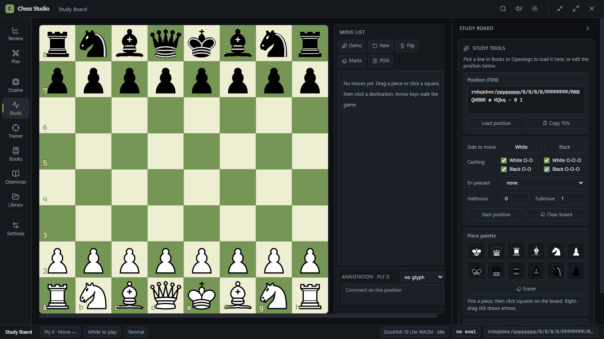
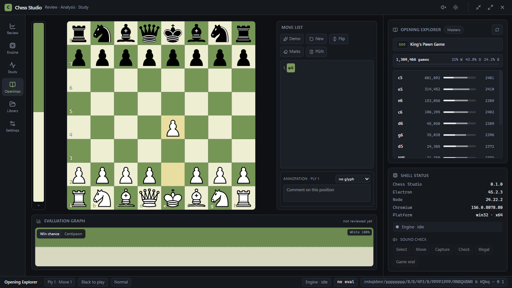
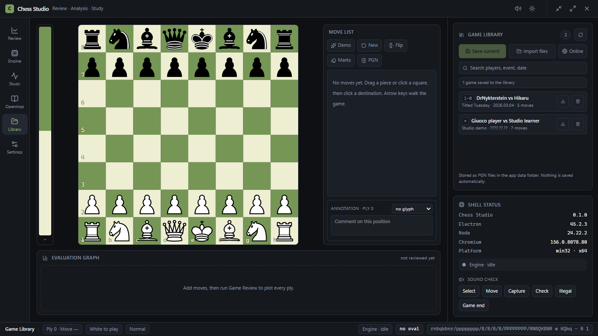
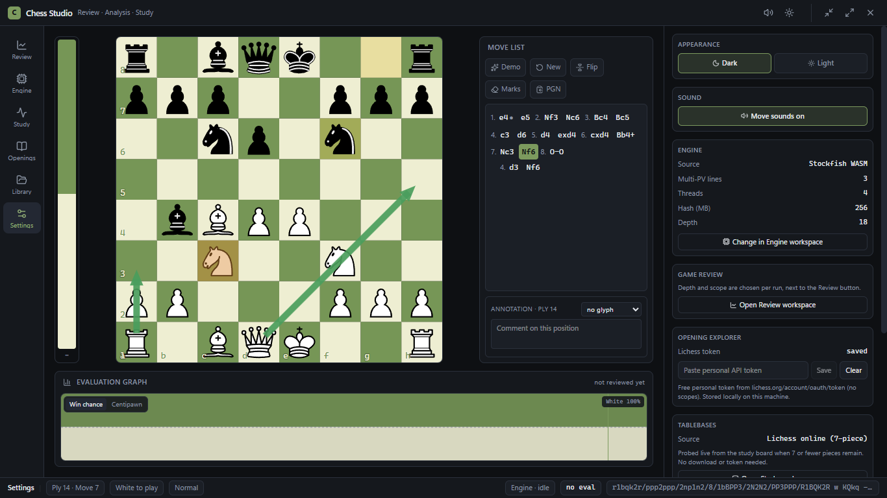

# Chess Studio

**Professional chess review, engine analysis and position study — a desktop app built with Electron, React and TypeScript.**

Chess Studio brings game review, Stockfish analysis, opening statistics, endgame tablebases, book study, a trainer and engine play into one fast desktop workspace. Import your games, replay them move by move, and get a per-move verdict with an evaluation graph, accuracy scores and clear annotations — then drill the mistakes, read a book beside a live board, or play a timed game.



## Features

### Game Review
- Run a Stockfish review over any game and get a **per-move classification**: Brilliant, Great, Best, Excellent, Good, Inaccuracy, Mistake, Blunder and Missed win.
- **Accuracy (CAPS)** and **average centipawn loss (ACPL)** for each side.
- Interactive **evaluation graph** (win chance or centipawn ladder) that links straight to the key moments.
- A **key moments** panel that jumps to the turning points of the game.
- Chess.com-style **move badges**, a best-move **arrow** on the board, and short explanations for blunders and brilliancies (local, with optional AI wording).
- A shareable **game report** with accuracy, phase breakdown and key moments.

### Engine Analysis
- **Stockfish 19 Lite (WebAssembly)** bundled — works out of the box, no install.
- Optional **native UCI engine** (e.g. `stockfish.exe`) for full strength and multithreading.
- Multi-PV principal variations, evaluation bar, engine arrows on the board, and configurable depth, threads, hash and Multi-PV lines.

### Study Board
- **FEN editor** with side to move, castling rights, en passant, halfmove and fullmove counters.
- **Piece palette** — place any piece (including custom positions) with click-to-place and an eraser.
- **Endgame tablebases** probed on the board whenever seven or fewer pieces remain.

### Opening Explorer
- Live **Lichess masters** statistics as you play: total games, win/draw/loss split, and the most common continuations with per-move frequency and average rating.

### Game Library
- **Save** the current game, **import** PGN files, or **fetch** games online from **Chess.com** (monthly archives by username) and **Lichess** (username streams or a single game ID).
- Search, export back to PGN, and delete — stored as plain PGN files in the app data folder.
- A library dashboard with opening, result and accuracy trends across saved games.

### Book Study
- Import a PDF and read it beside a live board: click a move line to follow it, or click a diagram to load its position.
- **Text, OCR and AI reading.** Text PDFs are parsed locally; scans use bundled Tesseract OCR or an optional vision model configured with your own provider key.
- Searchable **Contents**, saved reading position, per-page progress and honest processing status.
- Duplicate page headers and retried transcriptions are removed automatically when a book is assembled.

### Trainer
- Turn review turning points into **puzzles**: find the best move from the game's key moments.
- Track solved/attempted puzzles and revisit misses.

### Play
- Play against the engine with selectable levels, a clock and move list.

### Board & interface
- Drag-and-drop or click-to-move with legal-move highlighting; arrow keys walk the game.
- Position **annotations** (NAG glyphs) and free-text comments per move.
- Light and dark themes, move sounds, and a clean, keyboard-friendly layout.

## Screenshots

**Engine Analysis** — bundled Stockfish WASM or your own native UCI engine.



**Study Board** — FEN editor, piece palette and tablebase probes.



**Opening Explorer** — Lichess masters statistics for the current position.



**Game Library** — saved, imported and downloaded games.



**Settings** — appearance, sound, engine, opening-explorer token and tablebase source.



## Tech stack

| Layer | Technology |
| --- | --- |
| Shell | Electron 45 + electron-vite |
| UI | React 19 + TypeScript + Tailwind CSS 4 |
| Chess rules & PGN | chess.js |
| Engine | Stockfish 19 (WebAssembly) + native UCI |
| PDF & OCR | pdf.js + Tesseract.js |
| Optional AI | Your own vision/chat provider key (OpenRouter, Gemini, NVIDIA or compatible) |
| Piece art | cburnett SVG set |
| Online data | Lichess opening explorer & tablebase APIs |

## Getting started

**Prerequisites:** Node.js 20.19+ (or 22.12+) and npm.

```bash
npm install
```

| Command | What it does |
| --- | --- |
| `npm run dev` | Run the app in development with hot reload. |
| `npm run build` | Production build of the main, preload and renderer bundles into `out/`. |
| `npm run ocr:assets` | Copy the bundled Tesseract worker, WASM and English data into the renderer (also runs before `dev`/`build`). |
| `npm start` | Preview the production build (run `npm run build` first). |
| `npm run dist` | Build a Windows installer (NSIS) and a portable executable into `dist/`. |
| `npm run dist:dir` | Build an unpacked Windows app into `dist/`. |
| `npm run typecheck` | Type-check the main/preload and renderer projects. |

Packaging is configured for **Windows** (NSIS installer + portable). Development runs on any platform Electron supports.

## Engines

- **Stockfish WASM (default):** bundled with the app, runs single-threaded, and needs no setup.
- **Native UCI:** in the **Engine Analysis** workspace switch the source to *Native UCI* and browse to a `stockfish.exe` (or another UCI engine). Native engines unlock full strength and multithreading, and honour the thread and hash settings. The binary is not bundled — supply your own.

## Online services & data

- **Opening Explorer** uses the Lichess masters database. It needs a free Lichess **personal access token with no scopes**, created at <https://lichess.org/account/oauth/token> and pasted under **Settings → Opening Explorer**. The token is stored locally on your machine and sent only to Lichess.
- **Tablebases** are the Lichess 7-piece online tables — no token or download required.
- **Game Library** files are written to the app data folder as PGN. Nothing is saved automatically.
- **AI book reading and AI explanations are opt-in.** When enabled, page images or game text are sent to the provider you configure; keys are stored locally and are never sent anywhere else. Text/OCR book processing and the local review explanations stay on the machine.
- There is no telemetry. Network requests happen only when you use an online feature (Lichess openings/tablebases, Chess.com/Lichess imports, or your configured AI provider).

## Project structure

```
src/
├─ main/                 Electron main process
│  ├─ ai/                provider settings + fetch (OpenRouter/Gemini/NVIDIA)
│  ├─ book/              book store, PDF source, cached parses
│  ├─ engine/            WASM + native UCI engine management
│  ├─ library/           PGN library store + online imports
│  ├─ openings/          Lichess masters explorer + token store
│  ├─ tablebase/         Lichess 7-piece tablebase client
│  └─ trainer/           trainer puzzle store
├─ preload/              typed IPC bridge
├─ shared/               shared types + pure logic (fen, pgn, review, book, …)
└─ renderer/             React UI
   ├─ components/        workspace panels, board, eval graph, reader, …
   ├─ books/             PDF/text/OCR/AI book parsing and validation
   ├─ chess/             game / review / book / trainer logic
   ├─ hooks/             state + IPC hooks
   └─ public/            bundled Stockfish WASM + Tesseract assets
```

## License

Chess Studio is free software released under the **GNU General Public License v3.0 or later** (`GPL-3.0-or-later`). See [LICENSE](LICENSE) for the full text.

Bundled and linked third-party components and their licenses are documented in [NOTICE.md](NOTICE.md):

- **Stockfish** (GPL-3.0)
- **cburnett piece set** by Colin M. L. Burnett (GPL-2.0-or-later)
- **chess.js** (BSD-2-Clause)
- **pdf.js** (Apache-2.0), with OpenJPEG and JBIG2 components
- **Tesseract.js** (Apache-2.0)
- **React** (MIT)
- **Lucide** (ISC)
- **Electron** (MIT)

## Disclaimer

Chess Studio is an independent project and is not affiliated with or endorsed by Lichess, Chess.com, or the Stockfish project. Product names are used descriptively.
